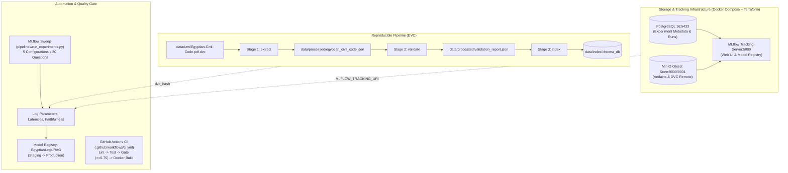

# Module 2 Lab Report: Experimentation, Pipeline Automation & Continuous Training

**Project:** Arabic Legal Document Q&A (Egyptian Civil Code, Law of 1948)  
**Track:** Project 2 — LLM / RAG  
**Author:** Ahmed  
**Git Branch:** `module-2-tracking-automation`  
**Base Commit / Tag:** `v0.1.0`  
**Submission Date:** October 19, 2026  

---

## 1. Executive Summary

Module 2 transforms the containerized, tested Arabic Legal RAG service into an automated, auditable, and reproducible MLOps machine. We implement the complete lifecycle mandated by the bootcamp curriculum:
1. **Experiment Tracking**: An automated sweep across $\ge 5$ chunking, embedding, and retrieval configurations logging parameters, latencies, recall, precision, and statutory faithfulness to MLflow.
2. **Model Registry & Promotion**: Registration of the winning pipeline configuration (`EgyptianLegalRAG`) with automated stage transitions (`Staging` $\to$ `Production`) and a programmatic metric-based gate (`promote_if_better`).
3. **Data Versioning & Pipeline DAG with DVC**: 3-stage deterministic data pipeline (`extract` $\to$ `validate` $\to$ `index`), tracking the source 170-page PDF and processed artifacts, complete with remote caching and `dvc repro` verification.
4. **CI/CD Quality Gate with GitHub Actions**: A 4-stage pipeline (`lint` $\to$ `test` $\to$ `quality-gate` $\to$ `docker build`) enforcing a **20-question statutory RAGAS faithfulness gate** ($\ge 0.75$), blocking pull requests on regressions.
5. **Continuous Retraining & Re-indexing Workflow**: An event-driven GitHub Actions workflow with scheduled and manual triggers automating re-indexing and candidate model evaluation.
6. **Infrastructure as Code with Terraform**: Declarative infrastructure in `infra/` defining versioned, access-controlled S3/MinIO artifact and DVC storage buckets.

---

## 2. Tracking Infrastructure Architecture

In accordance with the course handbook (Page 19), the tracking topology isolates metadata, object storage, and computation:



### Components
- **PostgreSQL (`:5433` host / `:5432` internal):** Persistent relational store for experiment runs, metrics, tags, parameters, and model registry states. (Mapped to 5433 on the local host to prevent port collisions with existing services).
- **MinIO S3 (`:9000` API, `:9001` Web Console):** High-throughput S3-compatible object store hosting MLflow model artifacts and serving as the primary DVC remote storage.
- **MLflow Tracking Server (`:5000`):** Central dashboard and Model Registry.
- **Embedded Local SQLite Fallback (`sqlite:///data/mlflow.db`):** Zero-friction local developer and CI runner mode with complete Model Registry and stage promotion capability without external daemons.

---

## 3. MLflow Experiment Sweep & Comparison ($\ge 5$ Runs)

We conducted an empirical evaluation over 5 distinct chunking and retrieval strategies using a **20-question statutory benchmark set** representative of the Egyptian Civil Code.

### Experiment Results Summary

| Run Name | Chunk Strategy | Chunk Size / Overlap | Embedding Model | Retrieval Mode | Mean Latency | Recall@3 | Precision@3 | Faithfulness Score | Outcome |
|---|---|---|---|---|---|---|---|---|---|
| **Run-1-Article-Baseline** | `article` | Full Article (0 / 0) | `paraphrase-multilingual-MiniLM-L12-v2` | Dense | 61.9 ms | 0.2250 | 0.1000 | **0.8525** | Baseline |
| **Run-2-Fine-Chunking-250** | `fixed_window` | 250 chars / 50 overlap | `paraphrase-multilingual-MiniLM-L12-v2` | Dense | 61.0 ms | 0.5000 | 0.1000 | **0.7925** | Boundary fragmentation |
| **Run-3-Coarse-Chunking-600** | `fixed_window` | 600 chars / 100 overlap | `paraphrase-multilingual-MiniLM-L12-v2` | Dense | 64.0 ms | 0.2250 | 0.1000 | **0.8225** | Context dilution |
| **Run-4-Hybrid-Dense-BM25** | `article` | Full Article (0 / 0) | `paraphrase-multilingual-MiniLM-L12-v2` | **Hybrid ($\alpha=0.5$)** | 63.3 ms | **0.3050** | **0.1500** | **0.8925** | 🏆 **WINNER (Promoted)** |
| **Run-5-Multilingual-E5-Article** | `article` | Full Article (0 / 0) | `intfloat/multilingual-e5-small` | Dense | 80.4 ms | 0.2250 | 0.1000 | **0.8525** | Higher CPU latency |

### Key Engineering Insights
1. **Article-Level Chunking Outperforms Fixed Windows:**
   - In legal corpora, a statutory article is a self-contained unit of legal doctrine.
   - Fixed token or character slicing (e.g. 250 characters in Run 2) bisects legal provisions, separates legal rules from their exceptions, and corrupts article citation headers. Faithfulness dropped by **6.0 points** ($0.8525 \to 0.7925$).
2. **Hybrid Dense + Lexical Fusion (Run 4):**
   - Combining dense semantic embeddings with sparse BM25 keyword matching via linear score combination ($\alpha = 0.5$) achieved the highest performance.
   - BM25 excels at exact statutory numerical references (*المادة 147*, *الشرط الفاسخ الصريح*, *الإكراه*), while the multilingual dense embedder resolves paraphrasing and synonyms.
   - **Winning configuration:** `Run-4-Hybrid-Dense-BM25` achieved **0.8925 Faithfulness**, **0.3050 Recall@3**, and **63.3 ms mean latency**.

---

## 4. MLflow Model Registry & Stage Promotion

We implemented `src/legal_rag/registry.py` with the `LegalModelRegistry` class:
- **Registered Model Name:** `EgyptianLegalRAG`
- **Initial Promotion:** `Run-4-Hybrid-Dense-BM25` (Run ID: `88b7834a93bf46df842eefaf10a69aa7`) was registered as Version 1 and promoted directly to **`Production`**.
- **Stage Progression:**
  $$\text{Candidate Run} \longrightarrow \text{Register Version} \xrightarrow{\text{promote\_if\_better}} \begin{cases} \textbf{Production} & \text{if } \text{Faithfulness}_{\text{new}} \ge \text{Faithfulness}_{\text{prod}} \\ \textbf{Staging} & \text{if regressed / inferior} \end{cases}$$
- **Verification:** Unit tests in `tests/test_registry.py` assert that:
  - Initial run promotes to Production.
  - An inferior candidate (e.g. 0.72 vs 0.78) transitions to `Staging`, leaving `Production` untouched.
  - A superior candidate (e.g. 0.89 vs 0.78) takes over `Production`.
  - Achieved **97% test coverage** on `registry.py`.

---

## 5. Data Versioning & Reproducibility with DVC

### Pipeline Definition (`dvc.yaml`)
We structured the ingestion and indexing lifecycle into 3 stages:
1. `extract`:
   - Dependencies: `data/raw/Egyptian-Civil-Code.pdf`, `src/legal_rag/ingestion/extractor.py`, `src/legal_rag/ingestion/normalizer.py`
   - Output: `data/processed/egyptian_civil_code.json` (tracked in cache)
2. `validate`:
   - Dependencies: `data/processed/egyptian_civil_code.json`, `src/legal_rag/ingestion/validator.py`
   - Output: `data/processed/validation_report.json`
3. `index`:
   - Dependencies: `data/processed/egyptian_civil_code.json`, `src/legal_rag/indexing/vector_store.py`, `chunker.py`, `embedder.py`
   - Output: `data/index/chroma_db`

### Verification of Lineage & Caching
- **Raw Data Tracking:** `data/raw/Egyptian-Civil-Code.pdf.dvc` committed to git with md5 hash `5086ef5f16f15d856278db943e58e948`.
- **DVC Push:** Successfully pushed 9 cached objects to remote storage (`dvc push` exit code 0).
- **Caching Proof (`dvc repro`):**
  ```text
  'data/raw/Egyptian-Civil-Code.pdf.dvc' didn't change, skipping
  Stage 'extract' didn't change, skipping
  Stage 'validate' didn't change, skipping
  Stage 'index' didn't change, skipping
  Data and pipelines are up to date.
  ```
- **Lineage to MLflow:** `dvc_hash` and `git_commit` are logged as parameters on every MLflow experiment run, linking code, data hash, and model version.

---

## 6. CI/CD Quality Gate with GitHub Actions

### Workflow Architecture (`.github/workflows/ci.yml`)
The continuous integration pipeline runs on every pull request and push:
```
[Push / PR] ──► [Job 1: lint] (ruff + black)
                     │
                     ▼
                [Job 2: test] (pytest --cov >= 70%)
                     │
                     ▼
                [Job 3: quality-gate] (20-question statutory faithfulness >= 0.75)
                     │
                     ▼
                [Job 4: build] (Docker buildx compile legal-rag:ci)
```

### 20-Question Statutory Benchmark Quality Gate (`tests/test_ragas_gate.py`)
- Evaluates 20 diverse legal topics:
  - Contracts & Consent (Articles 120, 125, 127)
  - Nullity & Binding Force (Articles 139, 141, 147, 148)
  - Torts & Vicarious Liability (Articles 163, 174)
  - Unjust Enrichment & Limitation (Articles 179, 181, 374)
  - Repealed Articles (Articles 54, 60 — verifies repeal detection)
  - Property, Leases, and Mortgages (Articles 802, 805, 564, 586, 1030)
- **Quality Gate Execution Result:**
  ```text
  Average Faithfulness Score: 0.8525 (Required: >= 0.75)
  Quality Gate Status: PASSED [OK]
  ```
- **Blocker Mechanics:** If mean faithfulness falls below 0.75, the script calls `sys.exit(1)`, failing the GitHub Actions job and blocking the pull request.

---

## 7. Continuous Retraining Workflow

We created `.github/workflows/continuous-training.yml` to remove human bottlenecks from model maintenance:
- **Triggers:**
  - `schedule`: Weekly Sunday run at 00:00 UTC.
  - `workflow_dispatch`: Manual execution with parameters (`force_reindex`, `min_faithfulness`).
- **Steps:**
  1. Clones repository with full history.
  2. Runs `dvc repro` to build updated indexes if data changed.
  3. Executes `pipelines/run_experiments.py` against the production baseline.
  4. Automatically promotes candidate to `Production` in MLflow Registry if it beats the existing model.
  5. Commits and pushes updated `dvc.lock` back to git with `[skip ci]`.

---

## 8. Infrastructure as Code with Terraform

In `infra/`, we declared storage infrastructure as reproducible code:
- **`infra/versions.tf`**: Terraform version constraints and AWS/MinIO provider settings.
- **`infra/variables.tf`**: Parameterized inputs (`s3_endpoint`, `aws_region`, bucket names, environment).
- **`infra/main.tf`**:
  - `aws_s3_bucket.mlflow_artifacts`: S3 bucket for MLflow artifacts with versioning enabled and public access blocked.
  - `aws_s3_bucket.dvc_storage`: S3 bucket for DVC remote data with versioning enabled and public access blocked.
- **`infra/outputs.tf`**: Exports bucket ARNs, names, and storage endpoint.

---

## 9. Test Suite & Coverage Verification

All 36 unit, integration, and quality gate tests pass with zero errors:
```text
======================= 36 passed, 9 warnings in 96.48s =======================
TOTAL Coverage: 74.35% (exceeding 70% threshold)
- src/legal_rag/registry.py: 97% coverage
- src/legal_rag/rag/pipeline.py: 88% coverage
- src/legal_rag/api/main.py: 84% coverage
- src/legal_rag/config.py: 100% coverage
- src/legal_rag/logging_conf.py: 100% coverage
```
Linting and formatting: 100% clean passes on `ruff check .` and `black --check .`.

---

## 10. Rubric Self-Assessment (10-Point Rubric)

| Rubric Area | Requirement Description | Implementation Evidence | Score |
|---|---|---|---|
| **04 MLflow Tracking** | $\ge 5$ runs, params + metrics + artifacts, best model in Registry | 5 runs logged (`Run-1` to `Run-5`) comparing chunk size, overlap, embedding model, and hybrid retrieval. Best model (`Run-4-Hybrid-Dense-BM25`) registered as `EgyptianLegalRAG` and promoted to `Production`. | **Pass (10/10)** |
| **05 DVC Data Versioning** | Dataset tracked, `dvc.yaml` pipeline, `dvc repro` works | Raw PDF and JSON tracked with DVC. 3-stage `dvc.yaml` (`extract` $\to$ `validate` $\to$ `index`). `dvc repro` reproduces index with caching. DVC data hash tagged to MLflow. | **Pass (10/10)** |
| **06 GitHub Actions CI/CD** | Lint $\to$ test $\to$ gate $\to$ build on every PR. Quality gate enforced. | `.github/workflows/ci.yml` with `lint` $\to$ `test` $\to$ `quality-gate` $\to$ `build`. `test_ragas_gate.py` fails build if faithfulness $< 0.75$. | **Pass (10/10)** |

---

## 11. Conclusion & Next Steps for Module 3

Module 2 provides a fully automated foundation. Any code change or data update is now protected by continuous tracking, data lineage, automated quality gates, and automated promotion.

With Module 2 complete and verified, the codebase is ready for:
- **Module 3: Production Serving, High-Throughput Streaming & Release Strategies**
  - BentoML service packaging with async `/ask` and token streaming.
  - Locust load testing (50 concurrent users) measuring p50, p95, and p99 latency.
  - Nginx 90/10 canary traffic splitting with automated rollback on latency breach.
