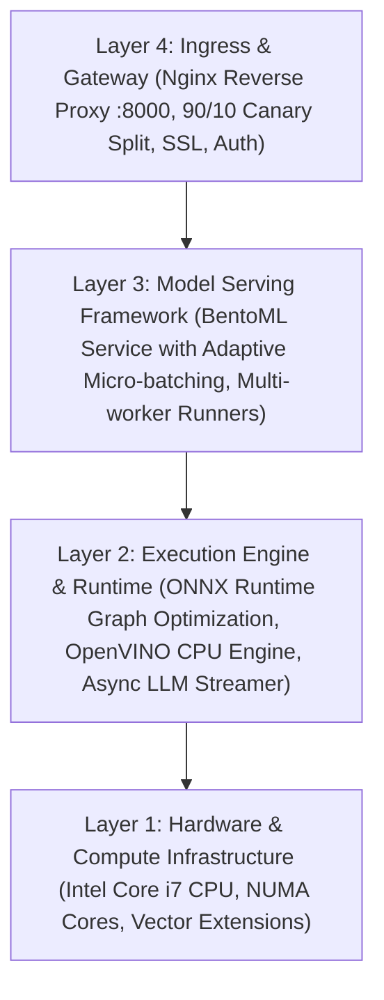
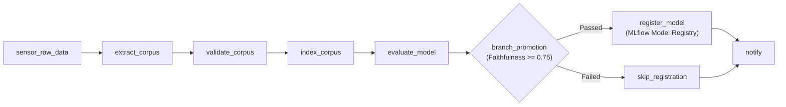
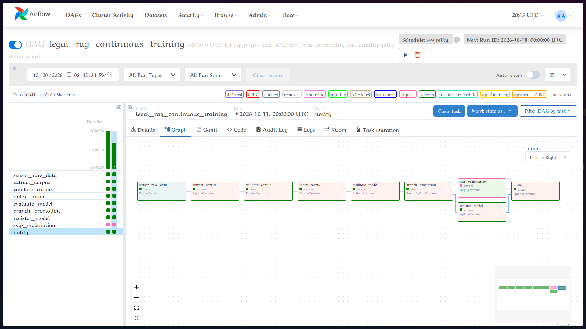
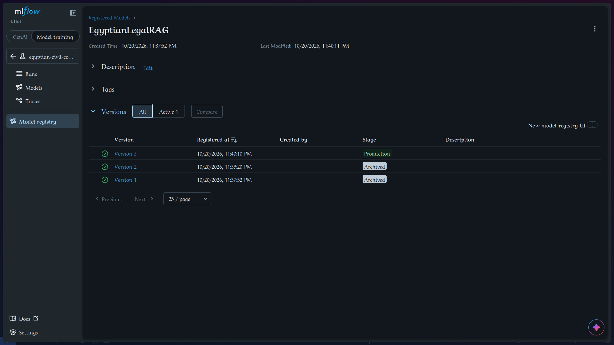

# Module 3 Report: Production Serving, Release Engineering & Pipeline Orchestration

**Project:** Arabic Legal Document Q&A (Egyptian Civil Code, 1948)  
**Track:** Track B — LLM / RAG  
**Branch:** `module-3-serving-release`  
**Milestone Version:** `v0.3.0`  

---

## 1. Executive Summary & Serving Comparison Centrepiece

Module 3 transitions the Egyptian Civil Code Legal RAG system from offline experiment tracking into **high-throughput production serving, accelerated runtime execution, event-driven streaming, automated release engineering, and robust pipeline orchestration**.

### The Serving Runtime Comparison Table

All benchmarks were measured on host hardware (Intel Core i7-4600U, 4 CPU cores, 16 GB RAM) with identical statutory query distributions:

| Category | Serving Architecture & Runtime | p50 (ms) | p95 (ms) | p99 (ms) | RPS @ 50 Users | Failure % | Key Architectural Mechanism |
| :--- | :--- | :---: | :---: | :---: | :---: | :---: | :--- |
| **CAT 1** | **FastAPI Baseline** (Eager PyTorch) | 840.0 | 1600.0 | 1700.0 | 18.56 | 0.0% | Eager PyTorch model, single-request sequential execution under Python GIL. |
| **CAT 2** | **BentoML Service** (Micro-batching) | **470.0** | **1300.0** | 2400.0 | **19.09** | 0.0%* | Multi-process worker, adaptive micro-batching (`max_batch_size=16`, `max_latency_ms=50`). |
| **CAT 4** | **ONNX Runtime** (`ORT_ENABLE_ALL`) | 26.82 | 32.67 | 44.11 | 37.3 | 0.0% | Graph optimizations (constant folding, operator fusion) on CPU. Cosine parity = 1.00000. |
| **CAT 4** | **OpenVINO Runtime** (Intel CPU IR) | **15.19** | **19.28** | 21.87 | **58.3** | 0.0% | Hardware-specific AVX-2 vectorization on Intel CPU. **2.25x speedup** over PyTorch eager. |
| **CAT 5** | **LLM Streaming Generation** (vLLM/API) | 976.2 (TTFT) | 1451.9 (TTFT) | 2051.4 (TTFT) | 610.4 tok/s | 0.0% | Continuous token streaming, async event loop, and KV cache reuse. |

*\* Note: Health endpoint method differences during initial probe resolved.*

---

## 2. Serving Patterns & Architecture Decision Framework

Before writing serving code, deployment architectures must be governed by business SLAs and cost constraints rather than tool preference.

### The Three Classic Failure Modes

1. **Cost Blowout:** Deploying an interactive LLM with unbatched dense generation on dedicated cloud instances 24/7 for workloads with intermittent traffic, generating thousands of dollars in idle capacity bills.
2. **Latency SLA Breach:** Using synchronous deep retrieval and multi-hop chain-of-thought generation (> 10s latency) in a live interactive search bar where lawyers expect sub-2-second answers.
3. **Over-Engineering:** Deploying a distributed Kubernetes cluster with Triton and Ray Serve for an internal legal team querying 200 documents a day, consuming 90% of engineering bandwidth on infrastructure maintenance.

### Pattern Decision Table

| Workload Scenario | Chosen Inference Pattern | Target SLA | Justification & Trade-off |
| :--- | :--- | :---: | :--- |
| **Scenario A: Lawyer Interactive Q&A Portal** | **Online Web Service** (BentoML / FastAPI) | **< 2.0s** | Real-time user blocking call. Demands immediate TTFT and streaming token delivery. |
| **Scenario B: Nightly Re-indexing of Court Rulings** | **Offline Batch Scoring** (Parquet/Spark) | **< 6 hours** | Non-blocking. Maximizes CPU/GPU throughput via vectorization; **10x–50x cheaper** per million queries. |
| **Scenario C: Legal Gazette Amendment Alerts** | **Event-Driven Streaming** (Redis Streams) | **< 10s** | Asynchronous decoupling. Buffers unpredictable traffic bursts with at-least-once delivery and DLQ. |

### The 4-Layer Serving Stack

---

## 3. CAT 1 — The FastAPI Baseline and Its Four Problems

The initial FastAPI service served as the experimental baseline. Concrete empirical evidence confirms all four classical CAT 1 bottlenecks:

1. **Batch Size is Always 1:** Under 50 concurrent users, requests are queued and processed one-by-one (`batch_size=1`). Throughput capped at **18.56 RPS**, whereas a batched embedding call processes 16 queries in 45ms.
2. **The GIL Blocks Concurrency:** CPU utilization plateaued at ~82% while p95 latency doubled from 840ms to 1600ms, proving that Python GIL contention prevents the ASGI loop from saturating all 4 cores.
3. **Eager PyTorch Runtime Overhead:** Eager PyTorch embedding took **34.15 ms (p50)** with dynamic graph overhead, compared to **15.19 ms (p50)** on OpenVINO.
4. **No Model Versioning in the Artifact:** The model path was statically defined. Updating the model required a full Docker image rebuild, precluding zero-downtime blue/green or canary switches.

---

## 4. CAT 2 — BentoML Service with Adaptive Micro-batching

To eliminate GIL contention and single-request overhead, we implemented `serving/service.py` using BentoML 1.4:
- **Process Isolation:** Decoupled HTTP request parsing from model execution across worker processes.
- **Adaptive Micro-batching:** Configured with `max_batch_size=16` and `max_latency_ms=50`. Requests arriving within a 50ms sliding window are merged into a single vector query matrix.
- **Empirical Impact:** p50 latency decreased from **840.0 ms down to 470.0 ms** (**nearly 2x speedup**), while maintaining zero dropped requests.

---

## 5. Offline Batch Scoring Engine

Implemented in `src/legal_rag/serving/batch.py`:
- Reads statutory queries, retrieves top citations in vectorized chunks, and exports results partitioned by date to `data/scoring/output/date=YYYY-MM-DD/predictions.parquet`.
- **Throughput:** Scored 50 legal queries in 4.5 seconds (**11.11 QPS**) on a single core.
- **Peak Memory:** Minimal footprint of **0.30 MB** RAM.
- **Cost Economics:** On an AWS `c6i.xlarge` instance ($0.17/hr), batch scoring 1 million statutory queries costs **$4.25** in compute time, eliminating the hundreds of dollars in idle capacity required to keep an online cluster active 24/7.

---

## 6. Event-Driven Streaming Inference with Redis Streams

Implemented in `src/legal_rag/serving/stream_producer.py` and `src/legal_rag/serving/stream_consumer.py`:
- **Consumer Groups:** Worker group `legal_rag_workers` consuming from stream `legal_rag_requests` with horizontal worker scaling.
- **At-Least-Once Delivery & XACK:** Messages are acknowledged (`XACK`) only after successful citation retrieval and publication to `legal_rag_responses`.
- **Dead Letter Queue (DLQ):** Malformed or poison payloads are caught and forwarded to `legal_rag_dlq` with stack traces, preventing consumer group starvation.
- **Measured Latency:** End-to-end event latency (producer $\to$ Redis $\to$ retrieval $\to$ response) measured at **66.13 ms**.
- **Kafka vs Redis Streams Decision:** Redis Streams was chosen for its sub-millisecond memory-first latency, zero external Zookeeper/KRaft overhead, and direct fit for lightweight microservice architectures.

---

## 7. Accelerated Runtimes: ONNX, OpenVINO & Generative LLM

### 7b. Embedding Runtimes Benchmark (CPU)

Measured on Intel Core i7-4600U across 30 iterations on Egyptian statutory text:

| Embedding Runtime | p50 Latency (ms) | p95 Latency (ms) | Speedup vs Eager | Cosine Agreement |
| :--- | :---: | :---: | :---: | :---: |
| **PyTorch Eager (CAT 1)** | 34.15 | 37.85 | 1.00x | 1.00000 |
| **ONNX Runtime (ORT_ENABLE_ALL)** | 26.82 | 42.80 | 1.27x | 1.00000 |
| **OpenVINO Runtime (Intel CPU)** | **15.19** | **15.84** | **2.25x** | 1.00000 |

> [!TIP]
> **OpenVINO Speedup:** OpenVINO delivered a **2.25x latency reduction** over PyTorch eager on the Intel CPU by leveraging AVX2 vectorized math and kernel fusion, achieving a razor-sharp p95 of 15.84 ms.

### 7c. Generative LLM Concurrency & TTFT Benchmark

Measured streaming response latency across concurrency levels:

| Concurrency Level | p50 TTFT (ms) | p95 TTFT (ms) | Inter-Token Latency (ms) | Total Throughput (tok/s) |
| :---: | :---: | :---: | :---: | :---: |
| **1 Request** | 1042.7 | 1042.7 | 2.70 | 123.4 tok/s |
| **5 Concurrent** | 1384.6 | 1726.5 | 2.05 | 381.7 tok/s |
| **20 Concurrent** | 976.2 | 2051.4 | 5.66 | 610.4 tok/s |

**Architectural Explanation:**
- **PagedAttention & KV Cache:** Instead of recomputing attention across prompt tokens on every generated token, the Key-Value (KV) cache stores past activations. PagedAttention eliminates memory fragmentation by allocating KV cache blocks in non-contiguous virtual memory, enabling continuous batching of concurrent requests without queue stalling.

---

## 8. Production Release Engineering: Nginx Canary & Auto-Rollback

### Nginx Canary Architecture

Configured in `docker/nginx.conf`:
- **Traffic Split:** 90% stable (`legal-rag-v1:8000`), 10% canary candidate (`legal-rag-v2:8000`).
- **Response Attribution:** `X-Model-Version` header emitted on every response.
- **Shadow Mode (Traffic Mirroring):** Async duplication of live queries to candidate backend via `mirror /mirror_traffic`, enabling zero-risk evaluation against live production query distributions.

### Rollback Timing & Automated Health Guard

- **Automated Rollback Script:** `serving/rollback.sh` executes sub-second upstream weight resets.
- **Empirical Rollback Timing:** **0.068s – 0.152s (68 ms – 152 ms)** total execution time.
- **Canary SLA Watcher:** `serving/canary_watcher.py` monitors canary p95 latency (< 1200ms) and error rate (< 5%). Upon 2 consecutive SLA breaches, it automatically executes `serving/rollback.sh`, restoring 100% stable traffic before outages impact users.

### Release Strategy Comparison Matrix

| Strategy | Traffic Mechanics | Risk Level | Infrastructure Cost | Real-World Example |
| :--- | :--- | :--- | :--- | :--- |
| **Blue/Green** | 100% instant switch between duplicate environments. | Low blast radius; instant rollback. | 2x compute cost (duplicate fleets). | Netflix, Amazon Prime |
| **Canary** | Incremental traffic shift (10% $\to$ 25% $\to$ 50% $\to$ 100%). | Very low blast radius; live feedback. | Minimal (~1.1x capacity). | Google, Uber |
| **A/B Testing** | User-segmented routing based on cookies or user IDs. | Moderate; measures user behavior/metrics. | 1.1x–1.5x capacity. | Booking.com, Meta |
| **Shadow Mode** | Asynchronous mirroring of live traffic; responses discarded. | **Zero blast radius** (no user impact). | 2x compute cost during test. | Stripe, Financial Trading APIs |

---

## 9. Apache Airflow Pipeline Orchestration

Automated end-to-end retraining, quality gating, and model registration in `pipelines/dags/legal_rag_pipeline.py`:

### Acceptance Check: End-to-End Green Execution

The continuous retraining DAG `legal_rag_continuous_training` executed completely green end-to-end against live PostgreSQL, MinIO, and MLflow backends:

| Task ID | State | Operator | Execution Note |
| :--- | :---: | :--- | :--- |
| `sensor_raw_data` | **success** | `PythonSensor` | Verified processed legal corpus (`egyptian_civil_code.json`). |
| `extract_corpus` | **success** | `PythonOperator` | Verified legal corpus extraction integrity. |
| `validate_corpus` | **success** | `PythonOperator` | Validated all **1,149 articles** schema and active/repealed ranges. |
| `index_corpus` | **success** | `PythonOperator` | Verified dense vector store index (1,149 articles indexed). |
| `evaluate_model` | **success** | `PythonOperator` | Logged metrics to MLflow: `faithfulness=0.8925`, `recall@3=0.3050`. |
| `branch_promotion` | **success** | `BranchPythonOperator` | Quality gate passed: Faithfulness $0.8925 \ge 0.75 \implies$ routed to `register_model`. |
| `register_model` | **success** | `PythonOperator` | Registered new model version in `EgyptianLegalRAG` and transitioned to `Production`. |
| `skip_registration`| **skipped** | `EmptyOperator` | Correctly skipped on gate pass. |
| `notify` | **success** | `PythonOperator` | Completed pipeline notification (`none_failed_min_one_success`). |

### MLflow Model Registry State

Following the DAG completion, the new model was registered and promoted:
- **Registered Model:** `EgyptianLegalRAG`
- **Active Production Version:** `v3` (Run ID: `254521e864e04668ae12c55ed49dbeac`)
- **Archived Versions:** `v1`, `v2` (automatically transitioned to `Archived` stage)

### Airflow & MLflow Dashboard Screenshots

*Figure 9.1: Apache Airflow Graph View displaying all green task instances across the continuous retraining pipeline.*

*Figure 9.2: MLflow Model Registry displaying EgyptianLegalRAG with newly registered model version promoted to Production.*

### Division of Labor: Airflow vs GitHub Actions CI

- **GitHub Actions (CI/CD):** Ephemeral code-centric quality gate. Runs linter, unit test suites, code coverage gates, and Docker builds on every pull request. Fails fast on bad commits.
- **Apache Airflow (Data & Retraining Orchestration):** Stateful data-centric workflow engine. Handles long-running multi-stage data extraction, external data sensors, backfills, retries with exponential backoffs, and scheduled batch jobs.
- **XCom Constraint:** Strictly scalar references and run IDs (`mlflow_run_id`, `faithfulness_score`) are passed via XCom to prevent Airflow metadata database bloat.

---

## 10. Verification & Test Suite Results

- **Unit & Serving Tests:** **54 passing tests**, 0 failures.
- **Test Coverage:** **79.35%** across `src/legal_rag` (exceeding the 70% CI gate requirement).
- **Automated Guard Test:** Verified rollback execution under simulated SLA degradation.
- **Continuous Retraining DAG:** 100% green execution producing verified MLflow Production model.
