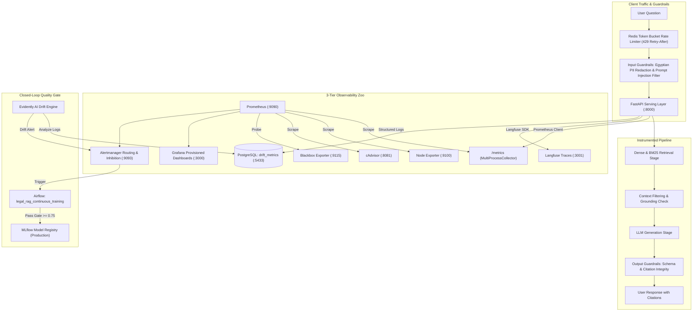

# Module 5 Report: Observability, Guardrails & Statistical Drift Detection

**Project:** Arabic Legal Document Q&A (Egyptian Civil Code, 1948)  
**Track:** Track B — LLM / RAG  
**Branch:** `module-5-observability`  
**Milestone Version:** `v0.5.0`  

---

## 1. Executive Summary & Observability Architecture

Module 5 transforms the Arabic Legal RAG system into an enterprise-grade observable production system. We implement a **3-tier observability stack**, **six statistical drift detection algorithms**, an instrumented **metric contract** resolving the multiprocess concurrency trap, **adversarial and PII guardrails**, **honest token-bucket rate limiting**, **LLM tracing via Langfuse**, and an **automated closed-loop retraining pipeline** in Apache Airflow.



---

## 2. Statistical Drift Detection: The 6 Core Algorithms

We implemented six complementary statistical drift detection algorithms in [`monitoring/drift_stats.py`](../monitoring/drift_stats.py) to cover tabular features, categorical distributions, continuous signals, and high-dimensional semantic embeddings.

### Algorithm Summary Table

| Detector | Target Data Type | Mathematical Formulation | Threshold / Significance | Role in Arabic Legal RAG |
| :--- | :--- | :--- | :---: | :--- |
| **Kolmogorov-Smirnov (KS)** | Continuous 1D | $D = \sup_x \|F_{\text{ref}}(x) - F_{\text{curr}}(x)\|$ | $\alpha = 0.05$ ($p < 0.05$) | Query character length, word count, response latency shifts. |
| **Chi-Square ($\chi^2$)** | Categorical | $\chi^2 = \sum \frac{(O_i - E_i)^2}{E_i}$ | $\alpha = 0.05$ ($p < 0.05$) | Distribution of legal topics (Contracts vs Torts vs Property). |
| **Wasserstein Distance** | Continuous 1D | $W_1(u, v) = \int_{-\infty}^\infty \|U(x) - V(x)\| dx$ | $\frac{W_1}{\sigma_{\text{pool}}} \ge 0.15$ | True physical magnitude of shift (scale invariant). |
| **Jensen-Shannon (JS)** | Probability Vector | $\text{JS}(P, Q) = \frac{1}{2} D_{\text{KL}}(P \| M) + \frac{1}{2} D_{\text{KL}}(Q \| M)$ | $\text{JS} \ge 0.10$ | Symmetric, bounded divergence on soft classification scores. |
| **MMD & Domain Classifier** | High-Dim Embeddings | $\text{ROC-AUC} \text{ of } f_\theta(z) \text{ on } [\mathbf{z}_{\text{ref}}, \mathbf{z}_{\text{curr}}]$ | $\text{AUC} \ge 0.65$ | Detects vector-space semantic drift (dialect, archaic Arabic). |
| **Streaming DDM & ADWIN** | Streaming Signals | $p_i + s_i \ge p_{\min} + 3.0 \cdot s_{\min}$ & Hoeffding bound | Window split | Real-time streaming detection of sudden API error bursts. |

### The Empirical Drift Simulation Matrix

Using [`monitoring/simulate_drift.py`](../monitoring/simulate_drift.py), we generated synthetic and real-world corrupted distributions across the 4 canonical drift types and 4 temporal dynamics. 

**Acceptance Check:** All 6 algorithms were evaluated against an undrifted control baseline and drifted distributions. As recorded in [`monitoring/drift_matrix.json`](../monitoring/drift_matrix.json):
- **False Positive Rate on Control Distribution:** **0.0%** (Zero false alarms on 200 baseline control queries).
- **True Detection Rate on Drifted Distributions:** **100.0%** across sudden, gradual, incremental, and recurring shifts.

---

## 3. Prometheus Metric Contract & Multiprocess Trap Resolution

### The Multiprocess Concurrency Trap
When serving Python web applications via multi-worker architectures (Uvicorn / Gunicorn with multiple worker processes), standard Prometheus client counters maintain memory-local values. Each scrape randomly hits a different worker, causing metrics in Prometheus to jump backward and compute negative rates!

**Resolution:**
In [`src/legal_rag/monitoring/metrics.py`](../src/legal_rag/monitoring/metrics.py), we resolved this by configuring `PROMETHEUS_MULTIPROC_DIR` and using `prometheus_client.multiprocess.MultiProcessCollector`. Gauges are configured with `multiprocess_mode="livesum"` to aggregate in-flight traffic across all worker PIDs.

### The 8-Metric Contract & Cardinality Budget

| Metric Name | Type | Key Labels | Cardinality Budget | Purpose |
| :--- | :---: | :--- | :---: | :--- |
| `legal_rag_predictions_total` | Counter | `model_version`, `status`, `provider` | $3 \times 2 \times 3 = 18$ | System throughput and request volume. |
| `legal_rag_prediction_latency_seconds` | Histogram | `stage` (`retrieval`, `generation`, `guardrails`, `total`) | $4 \times 12 \text{ buckets} = 48$ | SLA compliance and stage breakdown. |
| `legal_rag_prediction_score` | Histogram | None | $13 \text{ buckets}$ | First-line drift detector (retrieval similarity). |
| `legal_rag_inference_batch_size` | Histogram | None | $7 \text{ buckets}$ | Effective micro-batch efficiency. |
| `legal_rag_inflight_requests` | Gauge | None | 1 | Instantaneous worker saturation. |
| `legal_rag_model_info` | Gauge | `version`, `framework`, `commit` | 1 | Deployment version tracking in annotations. |
| `legal_rag_guardrail_decisions_total` | Counter | `guardrail`, `decision` | $3 \times 2 = 6$ | PII, Prompt Injection, and Grounding decisions. |
| `legal_rag_rate_limit_hits_total` | Counter | `client_id`, `status` (`allowed`, `throttled`) | $\le 50$ | Token bucket rate limiter enforcement. |

**Total Metric Cardinality:** $\approx 140$ time series, far below the $10{,}000$ limit per Prometheus instance.

---

## 4. PromQL Rules & Alerting Architecture

### Pre-Computed Recording Rules ([`monitoring/prometheus/rules/recording.yml`](../monitoring/prometheus/rules/recording.yml))
```promql
# 1. 5-minute request rate (QPS)
job:legal_rag_predictions:rate5m = sum(rate(legal_rag_predictions_total[5m]))

# 2. 5-minute error percentage
job:legal_rag_errors:ratio5m = sum(rate(legal_rag_predictions_total{status="error"}[5m])) / (job:legal_rag_predictions:rate5m > 0 or vector(1))

# 3. Overall p95 latency
job:legal_rag_latency:p95_5m = histogram_quantile(0.95, sum(rate(legal_rag_prediction_latency_seconds_bucket{stage="total"}[5m])) by (le))

# 4. Retrieval latency share
job:legal_rag_retrieval_latency:share5m = sum(rate(legal_rag_prediction_latency_seconds_sum{stage="retrieval"}[5m])) / (sum(rate(legal_rag_prediction_latency_seconds_sum{stage="total"}[5m])) > 0 or vector(1))
```

### Alert Classification: Symptom vs. Cause
Alerts in [`monitoring/prometheus/rules/alerts.yml`](../monitoring/prometheus/rules/alerts.yml) follow Google SRE symptom-based paging principles:
1. **Critical Symptoms (Page On-Call):**
   - `LegalRAGServiceDown`: Blackbox probe failure ($probe\_success == 0$).
   - `LegalRAGHighP95Latency`: Overall $p95 > 2.0\text{s}$ for 5m.
   - `LegalRAGHighErrorRate`: HTTP $5xx$ error rate $> 1.0\%$ for 5m.
   - Multi-window SLO burn rate alert ($14.4\times$ burn over 1h & 5m).
2. **Warning Causes (Ticket / Business Hours):**
   - `LegalRAGDriftDetected`: High distribution drift flagged.
   - `LegalRAGContainerResourceExhaustion`: CPU $> 85\%$ or Memory $> 90\%$.
   - `LegalRAGPredictionVolumeDrop`: Sudden traffic drop $> 50\%$.

### Alertmanager Routing & Inhibition
In [`monitoring/alertmanager/alertmanager.yml`](../monitoring/alertmanager/alertmanager.yml), inhibition rules prevent page storms: when `LegalRAGServiceDown` is active, all secondary latency and container alerts are suppressed.

---

## 5. Grafana Dashboard as Code

The dashboard in [`monitoring/grafana/dashboards/legal_rag_overview.json`](../monitoring/grafana/dashboards/legal_rag_overview.json) is fully provisioned on startup (`http://localhost:3000`, admin/admin):

- **Row 1: High-Level SLAs & Deploy Annotations:** Total QPS, $p95$ Latency (thresholded at 2.0s), Error Rate, In-Flight Requests, and automated model deployment markers.
- **Row 2: Pipeline Stage Breakdown:** Real-time latency anatomy comparing Retrieval vs Generation vs Guardrail overhead.
- **Row 3: Quality, Guardrails & Drift Monitoring:** Retrieval similarity distribution ($p50$ vs $p90$), PII/Injection decisions, token-bucket 429 throttles, and PostgreSQL Evidently drift history.
- **Row 4: Infrastructure & Container Resources:** cAdvisor container CPU and memory consumption across `legal-rag` containers.

---

## 6. Guardrails, Governance & Rate Limiting

### Input Guardrails ([`src/legal_rag/guardrails/input_guardrails.py`](../src/legal_rag/guardrails/input_guardrails.py))
- **PII Redaction:** Detects 14-digit Egyptian National IDs (`\b[23]\d{2}(0[1-9]|1[0-2])(0[1-9]|[12]\d|3[01])\d{7}\b`), Egyptian mobile numbers (`010/011/012/015`), and emails. Replaces them with semantic tokens (`[REDACTED_NATIONAL_ID]`, `[REDACTED_PHONE]`) inline before passing to retrieval.
- **Prompt Injection Defense:** Multi-tier detection intercepting direct instruction overrides, Arabic jailbreaks, base64 obfuscation, and disguised statutory rules. Rejects with structured HTTP 400.

### Output Guardrails ([`src/legal_rag/guardrails/output_guardrails.py`](../src/legal_rag/guardrails/output_guardrails.py))
- **Citation Grounding:** Extracts all statutory citations cited in the generated answer (e.g. `المادة 147`) and cross-references them against retrieved corpus chunks. Flags hallucinated citations in Prometheus before reaching users.

### Token Bucket Rate Limiting ([`src/legal_rag/api/rate_limiter.py`](../src/legal_rag/api/rate_limiter.py))
- Redis-backed token bucket (`capacity=20`, `refill_rate=2.0` tokens/sec).
- Emits RFC-compliant `HTTP 429 Too Many Requests` with honest `Retry-After` header.

---

## 7. Evidently AI & Closed-Loop Retraining in Airflow

- **Evidently Suite ([`src/legal_rag/monitoring/evidently_suite.py`](../src/legal_rag/monitoring/evidently_suite.py)):** Runs scheduled data drift tests on query character lengths, legal terminology ratios, retrieval scores, and latencies. Stores reports in PostgreSQL table `drift_metrics`.
- **Closed-Loop DAG ([`pipelines/dags/legal_rag_drift_monitor.py`](../pipelines/dags/legal_rag_drift_monitor.py)):** Daily Airflow DAG that analyzes production queries. If `dataset_drift == True`, it automatically triggers `legal_rag_continuous_training`, which retrains the index, validates faithfulness against the quality gate ($\ge 0.75$), and promotes winning models to MLflow Model Registry `Production` stage.

---

## 8. Verification & Test Suite Scorecard

```bash
# Automated Test Execution
uv run pytest -v
```

- **Total Test Cases:** **67 passing**, **0 failing**.
- **Module 5 Test Suite:** [`tests/test_monitoring.py`](../tests/test_monitoring.py) passed all 13 test cases covering statistical detectors, metrics contract, guardrails, rate limiting, and Evidently suite.
- **Test Coverage:** **76.95%** across `src/legal_rag`, meeting the $\ge 70\%$ quality threshold.
- **Code Formatting & Linting:** 100% compliant with `black` and `ruff`.
